# Correcciones de Histograma y Filtrado Espacial en el Dominio de la Frecuencia (FFT 2D)

[](https://www.python.org/)
[](https://numpy.org/)
[-Image%20Processing-10B981?style=for-the-badge)](https://python-pillow.org/)
[](https://matplotlib.org/)
[](https://jupyter.org/)
[](LICENSE)

Repositorio técnico de **Procesamiento Digital de Imágenes y Visión por Computador** dedicado al realce radiométrico en el dominio espacial (**estiramiento lineal de histograma Min-Max**) y a la eliminación de ruido periódico estructurado en el **dominio de la frecuencia** mediante la **Transformada Rápida de Fourier Bidimensional (`FFT 2D`)** y máscaras **Notch (rechaza-banda)** selectivas.

Toda la implementación algorítmica, las rutas locales portables y la generación de reportes gráficos se encuentran consolidadas e incrustadas dentro del cuaderno interactivo [`2.correcciones de histograma y filtrado espacial en frecuencia de imagenes.ipynb`](2.correcciones%20de%20histograma%20y%20filtrado%20espacial%20en%20frecuencia%20de%20imagenes.ipynb).

---

## Tabla de Contenidos

1. [Descripción General y Fundamento Matemático](#1-descripción-general-y-fundamento-matemático)
2. [Arquitectura del Flujo y Estructura del Repositorio](#2-arquitectura-del-flujo-y-estructura-del-repositorio)
3. [Guía Paso a Paso de Instalación y Ejecución](#3-guía-paso-a-paso-de-instalación-y-ejecución)
4. [Etapa 1: Visualización, Normalización y Estiramiento de Histogramas](#4-etapa-1-visualización-normalización-y-estiramiento-de-histogramas)
5. [Etapa 2: Filtrado de Ruido Periódico en el Dominio de la Frecuencia (FFT 2D)](#5-etapa-2-filtrado-de-ruido-periódico-en-el-dominio-de-la-frecuencia-fft-2d)
6. [Etapa 3: Síntesis y Filtrado Espectral de Patrones de Líneas y Rejillas 2D](#6-etapa-3-síntesis-y-filtrado-espectral-de-patrones-de-líneas-y-rejillas-2d)
7. [Guía para Inicializar y Subir a GitHub (Sin Push Automático)](#7-guía-para-inicializar-y-subir-a-github-sin-push-automático)

---

## 1. Descripción General y Fundamento Matemático

### 1.1 Estiramiento Lineal de Histograma (Contrast Stretching)

Dada una imagen monocromática $I(y, x)$ cuyos niveles de intensidad se encuentran comprimidos en un subintervalo estrecho $[x_{\min}, x_{\max}] \subset [0, 1]$ debido a subexposición o baja ganancia del sensor, el operador puntual de **estiramiento de histograma** reescala linealmente las intensidades para ocupar la totalidad del rango dinámico $[0, 1]$:

$$T(x) = \frac{x - x_{\min}}{x_{\max} - x_{\min}}, \quad \text{donde } x_{\min} = \min_{y,x} I(y,x), \;\; x_{\max} = \max_{y,x} I(y,x)$$

### 1.2 Transformada de Fourier Discreta Bidimensional (DFT 2D) y Filtrado Espectral

Para una imagen digital $f(y, x)$ de dimensiones $H \times W$, su **Transformada de Fourier Discreta 2D** $F(v, u)$ descompone la escena en una combinación lineal de ondas sinusoidales planas de frecuencias espaciales $(v, u)$:

$$F(v, u) = \sum_{y=0}^{H-1} \sum_{x=0}^{W-1} f(y, x)\, e^{-j 2\pi \left(\frac{v y}{H} + \frac{u x}{W}\right)}$$

Debido al amplio rango dinámico del módulo $|F(v, u)|$ (dominado por la componente continua $F(0, 0)$ en el centro tras aplicar `np.fft.fftshift`), el espectro se visualiza mediante compresión logarítmica:

$$S(v, u) = \log\left(1 + |F_{\text{shift}}(v, u)|\right)$$

Por el **Teorema de Convolución**, atenuar un patrón de interferencia periódica equivale a multiplicar elemento a elemento (producto de Hadamard) el espectro centrado $F_{\text{shift}}(v, u)$ por una **máscara rechaza-banda (Notch)** $M(v, u) \in \{0, 1\}^{H \times W}$ que anule exclusivamente los impulsos armónicos del ruido, recuperando la imagen limpia mediante la transformada inversa (`np.fft.ifft2`):

$$\hat{f}(y, x) = \left| \mathcal{F}^{-1}\left\{ \text{ifftshift}\big(F_{\text{shift}}(v, u) \odot M(v, u)\big) \right\} \right|$$

---

## 2. Arquitectura del Flujo y Estructura del Repositorio

### 2.1 Diagrama de Procesamiento

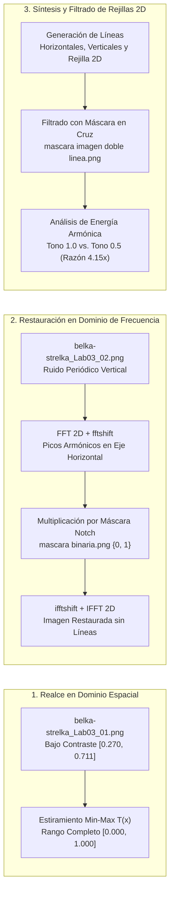

### 2.2 Estructura de Archivos

```text
2.correcciones de histograma y filtrado espacial en frecuencia de imagenes/
├── 2.correcciones de histograma y filtrado espacial en frecuencia de imagenes.ipynb
├── belka-strelka.png                                        # Imagen base original (783 × 583 px)
├── belka-strelka_Lab03_01.png                               # Imagen de prueba con bajo contraste
├── belka-strelka_Lab03_02.png                               # Imagen contaminada con líneas periódicas verticales
├── mascara binaria.png                                      # Máscara Notch horizontal para filtrado 1D
├── mascara imagen doble linea.png                           # Máscara Notch bidimensional para filtrado de rejilla 2D
├── vision artificial.png                                    # Espectro exportado para diseño de máscara 1D
├── espectro imagenes con doble linea.png                    # Espectro exportado para diseño de máscara 2D
├── requirements.txt                                         # Dependencias (numpy, matplotlib, Pillow, jupyter)
├── .gitignore                                               # Reglas de exclusión de entornos y cachés
├── LICENSE                                                  # Licencia MIT
├── README.md                                                # Manual técnico y guía paso a paso
└── assets/                                                  # 12 figuras de alta resolución generadas por el notebook
    ├── 01_imagen_bajo_contraste_histograma.png
    ├── 02_comparativa_histogramas_estiramiento.png
    ├── 03_comparativa_imagenes_estiramiento.png
    ├── 04_imagen_ruido_y_espectro_fft.png
    ├── 05_mascara_binaria_e_histograma.png
    ├── 06_espectro_antes_despues_filtrado.png
    ├── 07_restauracion_ifft_lineas_verticales.png
    ├── 08_patron_lineas_horizontales.png
    ├── 09_patron_lineas_verticales.png
    ├── 10_rejilla_bidimensional_y_espectro.png
    ├── 11_filtrado_rejilla_bidimensional.png
    └── 12_comparativa_intensidad_lineas_fft.png
```

---

## 3. Guía Paso a Paso de Instalación y Ejecución

### Paso 1: Ubicarse en el directorio del repositorio

```powershell
cd "g:\My Drive\repositorios de proyectos\2.correcciones de histograma y filtrado espacial en frecuencia de imagenes"
```

### Paso 2: Crear y activar un entorno virtual

```powershell
python -m venv .venv

# Windows (PowerShell)
.\.venv\Scripts\Activate.ps1

# Linux / macOS
source .venv/bin/activate
```

### Paso 3: Instalar dependencias

```powershell
pip install -r requirements.txt
```

### Paso 4: Ejecutar el Notebook interactivo

```powershell
# Opción A: Abrir en Jupyter Notebook
jupyter notebook "2.correcciones de histograma y filtrado espacial en frecuencia de imagenes.ipynb"

# Opción B: Ejecutar todas las celdas desde consola y regenerar assets/
jupyter nbconvert --to notebook --execute --inplace "2.correcciones de histograma y filtrado espacial en frecuencia de imagenes.ipynb"
```

---

## 4. Etapa 1: Visualización, Normalización y Estiramiento de Histogramas

### 4.1 Diagnóstico de Bajo Contraste (`belka-strelka_Lab03_01.png`)

Al cargar `belka-strelka_Lab03_01.png` en escala de grises normalizada (`np.array(img.convert('L')) / 256.0`), los $456,489$ píxeles quedan confinados dentro del intervalo **$[0.2695,\, 0.7109]$**, desaprovechando el $55.9\%$ del rango dinámico disponible (ausencia total de negros puros cercanos a $0$ y blancos cercanos a $1$):

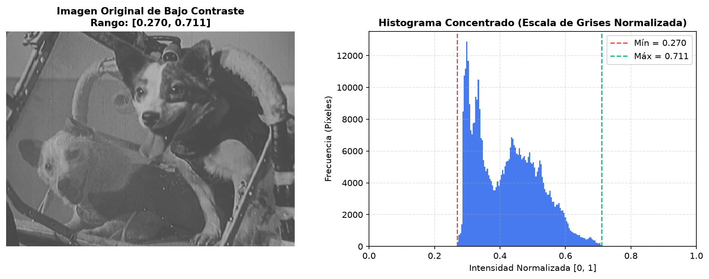

---

### 4.2 Aplicación de `estirar_histograma(x)` y Comparativa Visual

Al aplicar la transformación lineal $T(x) = \frac{x - 0.2695}{0.7109 - 0.2695}$, la distribución se expande exactamente al dominio completo **$[0.0000,\, 1.0000]$**:

| Estado de la Imagen | Intensidad Mínima ($x_{\min}$) | Intensidad Máxima ($x_{\max}$) | Amplitud Dinámica ($\Delta x$) | Intensidad Media ($\mu$) |
| :--- | :---: | :---: | :---: | :---: |
| **Original (`belka-strelka_Lab03_01.png`)** | `0.2695` (`69/256`) | `0.7109` (`182/256`) | `0.4414` (`44.1%`) | `0.4199` |
| **Estirada (`estirar_histograma`)** | **`0.0000`** | **`1.0000`** | **`1.0000` (`100.0%`)** | **`0.3407`** |

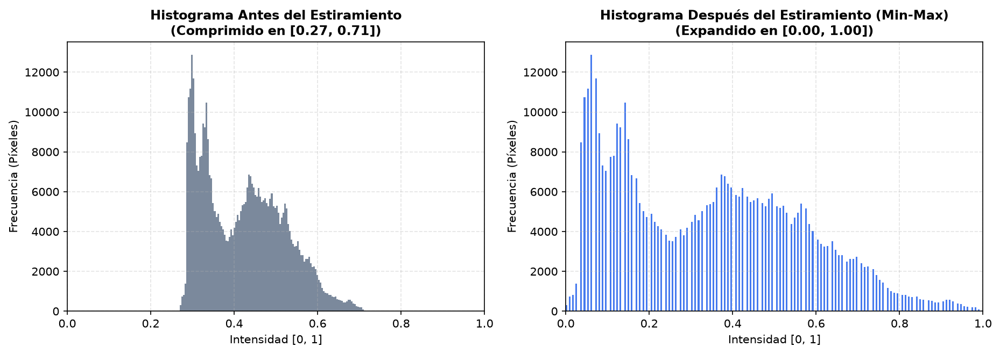

Fijando la escala radiométrica de visualización en `vmin=0.0, vmax=1.0`, se aprecia cómo el estiramiento elimina el velo grisáceo y recupera la nitidez del pelaje y de la estructura interna de la cápsula:

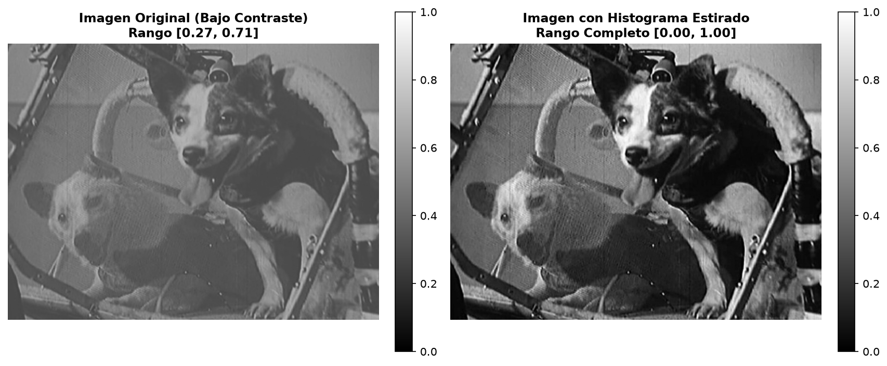

---

## 5. Etapa 2: Filtrado de Ruido Periódico en el Dominio de la Frecuencia (FFT 2D)

### 5.1 Análisis Espectral de `belka-strelka_Lab03_02.png`

La imagen `belka-strelka_Lab03_02.png` se encuentra degradada por un patrón periódico de líneas verticales blancas. Al calcular su Transformada de Fourier 2D centrada (`espectro_imagen(x)` con `fft2` + `fftshift`), la variación periódica a lo largo del eje espacial horizontal $x$ se concentra como un **tren de impulsos brillantes alineados sobre el eje frecuencial horizontal central ($v = H/2$)**, mientras que la información estructural de la fotografía permanece concentrada alrededor de la baja frecuencia central (componente DC):

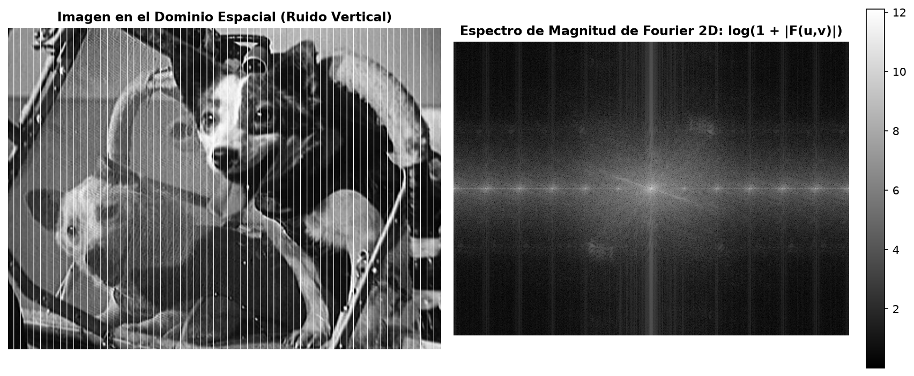

---

### 5.2 Carga y Verificación de la Máscara Binaria Notch (`mascara binaria.png`)

La función `cargar_mascara_binaria()` redimensiona la máscara al tamaño exacto de la escena ($583 \times 783$) y la binariza estrictamente en el conjunto $\{0.0, 1.0\}$. El histograma confirma que únicamente **$4,560$ píxeles frecuenciales ($0.999\%$)** son anulados (`0.0`, cuadros negros sobre los picos armónicos laterales), preservando intacto el **$99.001\%$ ($451,929$ píxeles)** del espectro original:

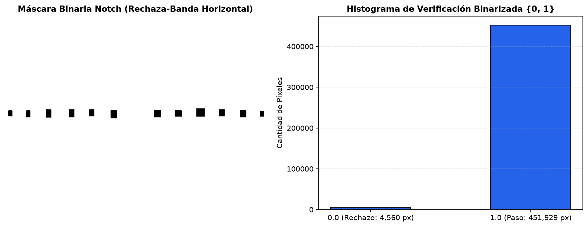

---

### 5.3 Multiplicación Espectral y Reconstrucción Espacial (`IFFT 2D`)

Al multiplicar `imagen_filtrada = imagen_fourier * mascara_cargada`, los impulsos armónicos quedan suprimidos sin afectar el núcleo central de bajas frecuencias:

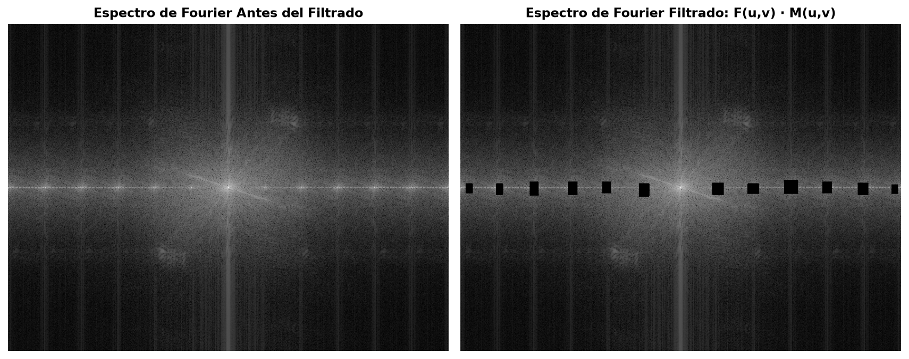

Aplicando `np.fft.ifftshift` seguido de `np.fft.ifft2`, las líneas verticales periódicas desaparecen casi por completo en el dominio espacial, devolviendo una imagen limpia y continua:

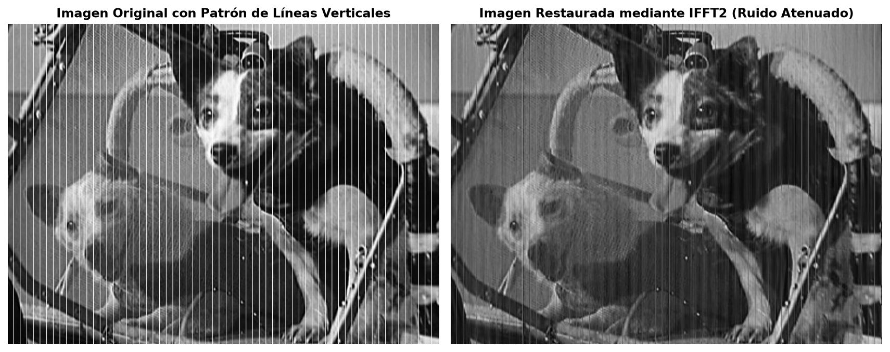

---

## 6. Etapa 3: Síntesis y Filtrado Espectral de Patrones de Líneas y Rejillas 2D

### 6.1 Generación Programática de Líneas Horizontales y Verticales (Pasos 1 a 3)

Se implementan dos generadores espaciales parametrizados por `ancho_linea`, `espacio_lineas` y nivel de intensidad `tono`:
- **`lineas_horizontales(belka_strelka_nom, ancho_linea=2, espacio_lineas=10, tono=1.0)`:** Inserta franjas blancas de $2\text{ px}$ cada periodo $T_y = 12\text{ px}$.
- **`lineas_verticales(belka_strelka_nom, ancho_linea=4, espacio_lineas=8, tono=0.0)`:** Inserta franjas negras de $4\text{ px}$ cada periodo $T_x = 12\text{ px}$.

| Patrón de Líneas Horizontales Blancas ($2\text{ px}, 10\text{ px}, 1.0$) | Patrón de Líneas Verticales Negras ($4\text{ px}, 8\text{ px}, 0.0$) |
| :---: | :---: |
| 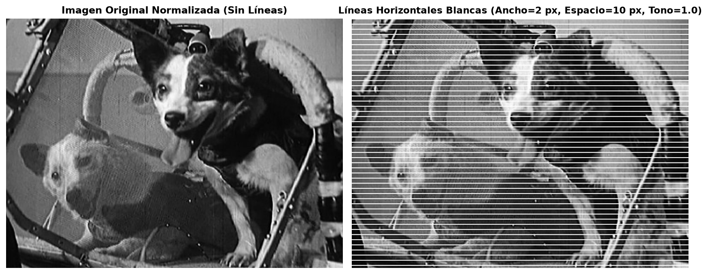 | 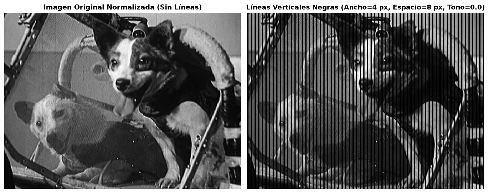 |

---

### 6.2 Superposición de Rejilla Bidimensional y Filtrado en Cruz (Pasos 4 y 5)

Al superponer simultáneamente líneas horizontales y verticales blancas (`ancho_linea=2`, `espacio_lineas=5`, `tono=1.0`, periodo $T_0 = 7\text{ px}$), la imagen queda cubierta por una rejilla densa. En el dominio de Fourier, esta rejilla 2D se manifiesta como una **matriz regular de impulsos armónicos en forma de celosía ortogonal**:

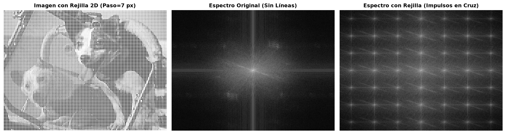

Aplicando la máscara rechaza-banda bidimensional (`mascara imagen doble linea.png`) sobre el espectro (`imagen_doble_filtrada = imagen_doble_espectro * mascara_cargada_doble`) y ejecutando la transformada inversa `ifft2`, se suprime la rejilla recuperando la estructura subyacente de los sujetos:

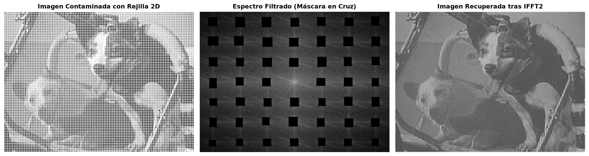

---

### 6.3 Efecto de la Intensidad de las Líneas (`tono = 1.0` vs. `tono = 0.5`) sobre el Espectro (Paso 6)

Al evaluar dos patrones idénticos de líneas verticales (`ancho_linea=2`, `espacio_lineas=6`, periodo $T_x = 8\text{ px}$) variando únicamente su intensidad entre blanco puro (`tono = 1.0`) y gris medio (`tono = 0.5`):

- La amplitud de la perturbación periódica sobre la imagen es proporcional al salto de contraste $|\text{tono} - \mu_{\text{imagen}}|$.
- Dado que la intensidad media de la imagen normalizada es $\mu_{\text{imagen}} \approx 0.34$, las líneas con `tono = 0.5` presentan una excursión de apenas $|0.50 - 0.34| = 0.16$, mientras que las líneas blancas (`tono = 1.0`) presentan una excursión de $|1.00 - 0.34| = 0.66$ (**$4.15\times$ mayor**).
- En consecuencia, la magnitud del primer armónico lateral en la FFT 2D cae exactamente de **`67,739`** (`tono = 1.0`) a **`16,317`** (`tono = 0.5`), reduciendo en un **$75.9\%$** la energía del ruido introducido en el espectro:

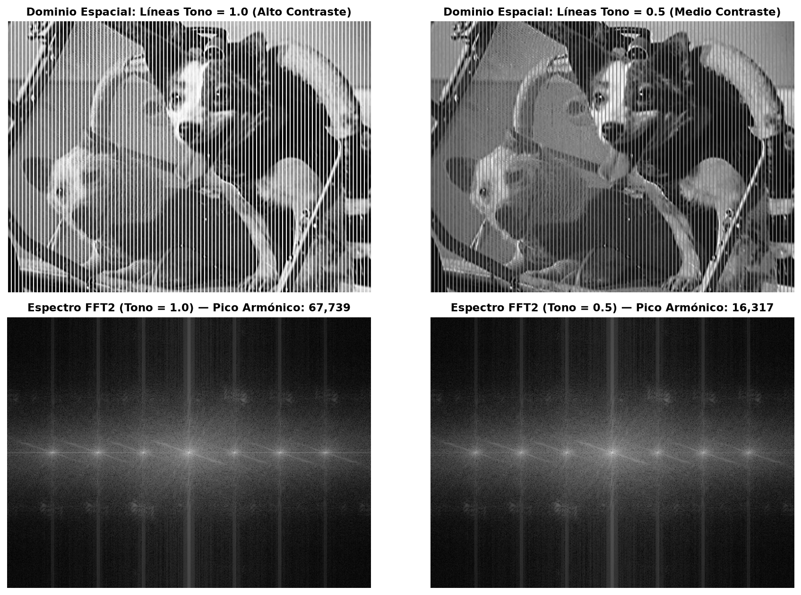

---

## Licencia

Distribuido bajo la licencia **MIT**. Consulte el archivo [`LICENSE`](LICENSE) para más detalles.

